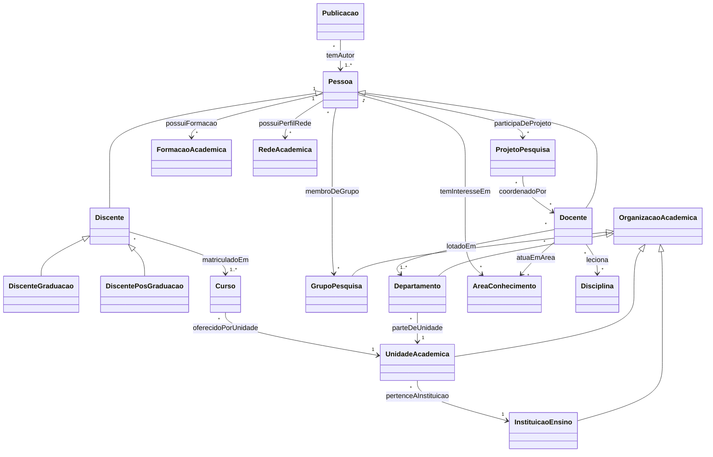

# Documentação da Ontologia de Aplicação (`acad:`)

- **Arquivo:** `ontologia/ontologia.owl` (serializada em sintaxe **Turtle**)
- **Namespace:** `https://davidsonwasserman.github.io/trabalho-web-semantica/ontologia/ontologia.owl#`
- **Prefixo:** `acad:`
- **Compatibilidade:** OWL 2 DL — validada com `rdflib` e estruturada para abertura direta no **Protégé** com o raciocinador **HermiT**.

---

## 1. Visão Geral e Diagrama

O diagrama completo encontra-se em `documentacao/diagrama.svg` (fonte Mermaid em `documentacao/diagrama.mmd`). A estrutura central separa:
1. **Agentes:** `Pessoa`, especializada em `Docente` e `Discente` (`DiscenteGraduacao`, `DiscentePosGraduacao`);
2. **Estrutura Organizacional:** `OrganizacaoAcademica` (`InstituicaoEnsino`, `UnidadeAcademica`, `Departamento`, `GrupoPesquisa`) e `Curso`;
3. **Produção e Atividades:** `AreaConhecimento`, `Disciplina`, `ProjetoPesquisa`, `Publicacao`, `FormacaoAcademica` e `RedeAcademica`.



---

## 2. Hierarquia de Classes e Alinhamentos Externos

```text
owl:Thing
├── acad:Pessoa  (⊑ foaf:Person, schema:Person)
│   ├── acad:Docente
│   ├── acad:Discente
│   │   ├── acad:DiscenteGraduacao
│   │   └── acad:DiscentePosGraduacao
│   ├── acad:PesquisadorEmProjeto   [Classe Definida]
│   └── acad:AutorAcademico         [Classe Definida]
├── acad:OrganizacaoAcademica  (⊑ foaf:Organization, schema:Organization)
│   ├── acad:InstituicaoEnsino      (⊑ schema:CollegeOrUniversity)
│   ├── acad:UnidadeAcademica
│   ├── acad:Departamento
│   └── acad:GrupoPesquisa
├── acad:Curso                      (⊑ schema:EducationalOccupationalProgram)
├── acad:AreaConhecimento           (⊑ skos:Concept)
├── acad:Disciplina                 (⊑ schema:Course)
├── acad:ProjetoPesquisa            (⊑ foaf:Project, schema:ResearchProject)
├── acad:Publicacao                 (⊑ bibo:AcademicArticle, schema:ScholarlyArticle)
├── acad:FormacaoAcademica
└── acad:RedeAcademica
```

---

## 3. Axiomas, Restrições OWL 2 e Disjunções

### 3.1. Restrições de Classes (Sintaxe Manchester)

| Classe | Axioma / Restrição OWL | Significado |
| :--- | :--- | :--- |
| `acad:Docente` | `SubClassOf: lotadoEm min 1 Departamento` | Todo docente deve estar lotado em pelo menos 1 departamento. |
| `acad:Discente` | `SubClassOf: matriculadoEm min 1 Curso` | Todo discente deve estar matriculado em pelo menos 1 curso. |
| `acad:ProjetoPesquisa` | `SubClassOf: temParticipante min 1 Pessoa` | Todo projeto deve possuir pelo menos 1 participante acadêmico. |
| `acad:Publicacao` | `SubClassOf: (temAutor min 1 Pessoa) and (tituloPublicacao exactly 1 xsd:string) and (anoPublicacao exactly 1 xsd:integer)` | Toda publicação possui obrigatoriamente ao menos 1 autor, exatamente 1 título e 1 ano inteiro. |

### 3.2. Classes Definidas (`owl:equivalentClass`)

| Classe Definida | Expressão Equivalente | Finalidade de Inferência |
| :--- | :--- | :--- |
| `acad:PesquisadorEmProjeto` | `Pessoa and (participaDeProjeto some ProjetoPesquisa)` | Classifica automaticamente qualquer docente ou discente que participe de um projeto de pesquisa. |
| `acad:AutorAcademico` | `Pessoa and (autorDe some Publicacao)` | Classifica automaticamente qualquer pessoa ligada como autora via `temAutor` (inferido pelo inverso `autorDe`). |

### 3.3. Disjunções Declaradas
- `AllDisjointClasses`: `Pessoa`, `OrganizacaoAcademica`, `Curso`, `AreaConhecimento`, `Disciplina`, `ProjetoPesquisa`, `Publicacao`, `FormacaoAcademica`, `RedeAcademica`.
- `AllDisjointClasses`: `InstituicaoEnsino`, `UnidadeAcademica`, `Departamento`, `GrupoPesquisa`.
- **Decisão intencional:** `acad:Docente` e `acad:Discente` **não** são disjuntas, permitindo modelar docentes que também cursam pós-graduação.

---

## 4. Propriedades de Objeto, Características e Inversas

| Propriedade | Domínio | Alcance | Características / Inversa |
| :--- | :--- | :--- | :--- |
| `acad:lotadoEm` | `acad:Docente` | `acad:Departamento` | `inverseOf acad:temDocenteLotado` |
| `acad:matriculadoEm` | `acad:Discente` | `acad:Curso` | `inverseOf acad:temDiscenteMatriculado` |
| `acad:parteDeUnidade` | `acad:Departamento` | `acad:UnidadeAcademica` | `Functional`, `inverseOf acad:possuiDepartamento` |
| `acad:oferecidoPorUnidade` | `acad:Curso` | `acad:UnidadeAcademica` | `Functional`, `inverseOf acad:ofereceCurso` |
| `acad:pertenceAInstituicao` | `acad:OrganizacaoAcademica` | `acad:InstituicaoEnsino` | `Functional` |
| `acad:vinculadoAUnidade` | `acad:Pessoa` | `acad:UnidadeAcademica` | `inverseOf acad:possuiPessoaVinculada` |
| `acad:atuaEmArea` | `acad:Docente` | `acad:AreaConhecimento` | — |
| `acad:temInteresseEm` | `acad:Pessoa` | `acad:AreaConhecimento` | — |
| `acad:leciona` | `acad:Docente` | `acad:Disciplina` | `inverseOf acad:lecionadaPor` |
| `acad:participaDeProjeto` | `acad:Pessoa` | `acad:ProjetoPesquisa` | `inverseOf acad:temParticipante` |
| `acad:coordenadoPor` | `acad:ProjetoPesquisa` | `acad:Docente` | `inverseOf acad:coordenaProjeto` (`coordenaProjeto ⊑ participaDeProjeto`) |
| `acad:membroDeGrupo` | `acad:Pessoa` | `acad:GrupoPesquisa` | `inverseOf acad:temMembroGrupo` |
| `acad:temAutor` | `acad:Publicacao` | `acad:Pessoa` | `inverseOf acad:autorDe` |
| `acad:possuiFormacao` | `acad:Pessoa` | `acad:FormacaoAcademica` | — |
| `acad:realizadaEmInstituicao` | `acad:FormacaoAcademica` | `acad:InstituicaoEnsino` | — |
| `acad:possuiClassificacaoSKOS` | `acad:Pessoa` | `skos:Concept` | Liga à taxonomia facetada `pes:` |
| `acad:possuiPerfilRede` | `acad:Pessoa` | `acad:RedeAcademica` | — |

---

## 5. O que é Inferido pelo Raciocinador vs. Resolvido em SPARQL

| Cenário | Mecanismo Responsável | Explicação Técnica |
| :--- | :--- | :--- |
| Classificar `DocenteAnaSilva` ou `DiscenteMarianaSouza` em `acad:PesquisadorEmProjeto` e `acad:AutorAcademico` | **Raciocinador OWL (HermiT)** | A partir das declarações `participaDeProjeto` e da inversa `autorDe` (de `temAutor`), o HermiT satisfaz as classes definidas (`owl:equivalentClass`). |
| Propagar `autorDe`, `temParticipante`, `coordenaProjeto ⊑ participaDeProjeto` | **Raciocinador OWL (HermiT)** | Axiomas `owl:inverseOf` e `rdfs:subPropertyOf` derivam automaticamente as relações reversas e hierárquicas. |
| Detectar inconsistência caso uma `Publicacao` tenha 2 títulos ou 1 recurso seja simultaneamente `Pessoa` e `Publicacao` | **Raciocinador OWL (HermiT)** | Garantido por `owl:FunctionalProperty` / `qualifiedCardinality 1` e `AllDisjointClasses`. |
| Navegar de `Pessoa` até `UnidadeAcademica` sem duplicar propriedades obrigatórias e listar coautores (`?coautor != ?docente`) | **Consultas SPARQL 1.1 (`consultas/consulta05.rq`, `consulta06.rq`)** | Property Paths `(lotadoEm/parteDeUnidade)|(matriculadoEm/oferecidoPorUnidade)` e filtros de desigualdade (`FILTER`) sobre suposição de mundo aberto (OWA) são resolvidos de forma declarativa em SPARQL. |
